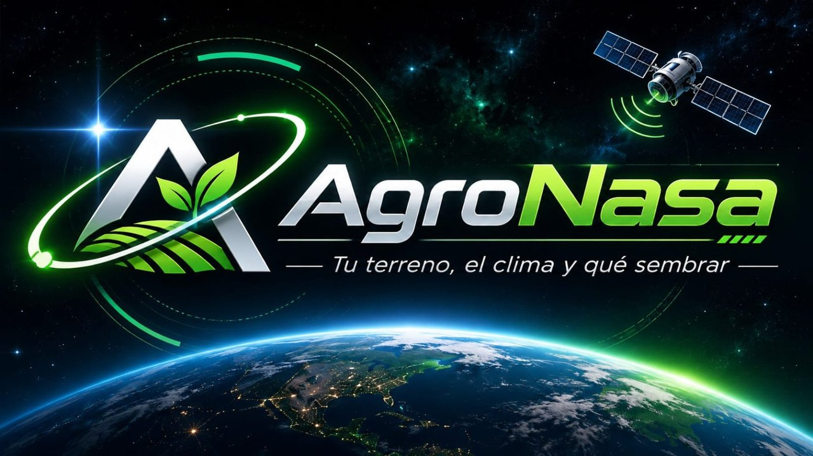

<p align="center"></p>

# 🌱 AgroNASA — Recomendador Agroclimático de Cultivos con Datos NASA

Aplicación web creada para la Hackathon de la NASA que traduce datos de observación de la Tierra (**NASA POWER Agroclimatology + MODIS NDVI**) en recomendaciones explicables de siembra, alertas de anomalías hídricas/heladas y planes de rotación de cultivos para pequeños y medianos agricultores.

---

## ✨ Funcionalidades Principales

1. **Mapa Interactivo y Zonas Agroclimáticas (P0):**
   - Selección de cualquier coordenada en el mapa mundial (Leaflet + OpenStreetMap), geolocalización del navegador y botones rápidos para 4 zonas de referencia contrastantes (*Valles de Cochabamba*, *Altiplano de La Paz*, *Llanos Tropicales de Santa Cruz* y *Sierra de Cusco*).
2. **Cliente NASA POWER con Caché por Celda y Respaldo Offline (P0):**
   - Consulta de `T2M`, `T2M_MAX`, `T2M_MIN`, `PRECTOTCORR`, `RH2M`, `GWETROOT` y `ALLSKY_SFC_SW_DWN` en la malla de `0.5° × 0.625°`, filtrado de valores `-999`, caché en memoria/disco y fixtures precargados para demos sin riesgo de caída de red.
3. **Motor Trapezoidal de Recomendación Explicable (P0):**
   - Basado en **FAO EcoCrop** con evaluación de ventana fenológica según el mes de siembra (o búsqueda automática del mejor mes entre los 12 meses del año), media geométrica ponderada, detección del factor limitante y explicación en lenguaje sencillo.
4. **Alertas por Percentiles Históricos de 20 Años (P1):**
   - Clasificación de sequía severa (`<10`), déficit (`10–25`), normal (`25–75`), exceso (`75–90`) y riesgo de inundación (`>90`) en ventanas de 30 y 60 días, reforzada con humedad radicular (`GWETROOT`) y umbral de heladas (`T2M_MIN`).
5. **Explorador de Viabilidad por Categorías (P1):**
   - Catálogo validado de 15 cultivos en 6 categorías (`cereales`, `tuberculos_raices`, `legumbres`, `hortalizas`, `oleaginosas`, `frutas`).
6. **Módulo de Suelo y Rotación Agroecológica en 4 Ciclos (P2):**
   - Ajuste por pH, textura, drenaje, materia orgánica y nitrógeno + generador de rotación (sin repetir familias botánicas, alternando leguminosas fijadoras de N, profundidades de raíz y abono verde).
7. **Segundo Dataset NASA (P2):**
   - Visualización conjunta de humedad en zona de raíces (`GWETROOT`) e índice de vigor vegetal (`MODIS NDVI`).

---

## 🚀 Ejecución Rápida

### 1. Ejecutar localmente con Python (Backend + Interfaz Web integrada)

```bash
# Usando el entorno virtual ya configurado en el proyecto:
PYTHONPATH=backend .venv/bin/uvicorn app.main:app --host 0.0.0.0 --port 8000
```

Abre en tu navegador:
- **Aplicación Web Interactiva:** `http://localhost:8000`
- **Documentación Swagger / OpenAPI:** `http://localhost:8000/docs`

### 2. Ejecutar Pruebas Automatizadas (`pytest`)

```bash
PYTHONPATH=backend .venv/bin/pytest backend/tests -v
```

### 3. Ejecutar con Docker

```bash
docker compose up --build
```

---

## 📂 Estructura del Proyecto

```text
.
├── README.md
├── docker-compose.yml
├── backend/
│   ├── app/
│   │   ├── main.py            # Rutas FastAPI + servidor de interfaz web
│   │   ├── nasa_client.py     # Cliente NASA POWER + caché + zonas demo
│   │   ├── climate.py         # Climatología mensual y ventanas de cultivo
│   │   ├── alerts.py          # Percentiles históricos y alertas semáforo
│   │   ├── scoring.py         # Funciones trapezoidales EcoCrop y explicaciones
│   │   ├── rotation.py        # Motor de rotación agroecológica en 4 ciclos
│   │   └── schemas.py         # Modelos Pydantic de entrada/salida
│   ├── data/crops.json        # Base de 15 cultivos con parámetros agronómicos
│   ├── tests/test_agronasa.py # Pruebas unitarias y de integración
│   ├── requirements.txt
│   └── Dockerfile
├── frontend/
│   ├── dist/index.html        # página única lista para usar (Leaflet; mapa a pantalla completa + menú lateral en acordeón)
│   ├── src/                   # Componentes modulares React + Vite + Recharts
│   ├── package.json
│   └── vite.config.js
├── docs/
│   └── metodologia_y_pitch.md # Metodología detallada y guion de pitch (3 min)
└── .github/workflows/ci.yml   # Integración continua con GitHub Actions
```
